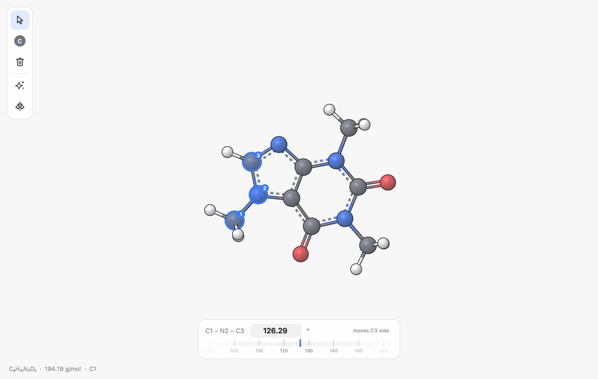

MILES
=====

**Molecular Improvisation & Ligand Exploration Studio**

*Kind of cool. Kind of molecular. Improvise your structures.*

MILES is a fast molecule builder and 3D viewer for proteins, ligands,
binding pockets and small molecules. You build structures by clicking and
dragging, open almost any chemistry file format,
download proteins by their PDB code and export pictures ready for a paper.
Atoms, bonds and protein cartoons are drawn on the GPU, so the view stays
smooth with thousands of atoms.

   The window: the canvas fills it, the tool rail floats on the left and the
   selection panel appears at the bottom when atoms are selected.

This documentation has three parts.

:doc:`userguide/index`
   How to install and run MILES, and how to build, edit, view and
   export structures.

:doc:`developerguide/index`
   How the program is organised, how its algorithms work and how to change
   or extend it.

:doc:`api/index`
   Every public module, class and function, generated from the source.

.. toctree::
   :hidden:

   userguide/index
   developerguide/index
   api/index
