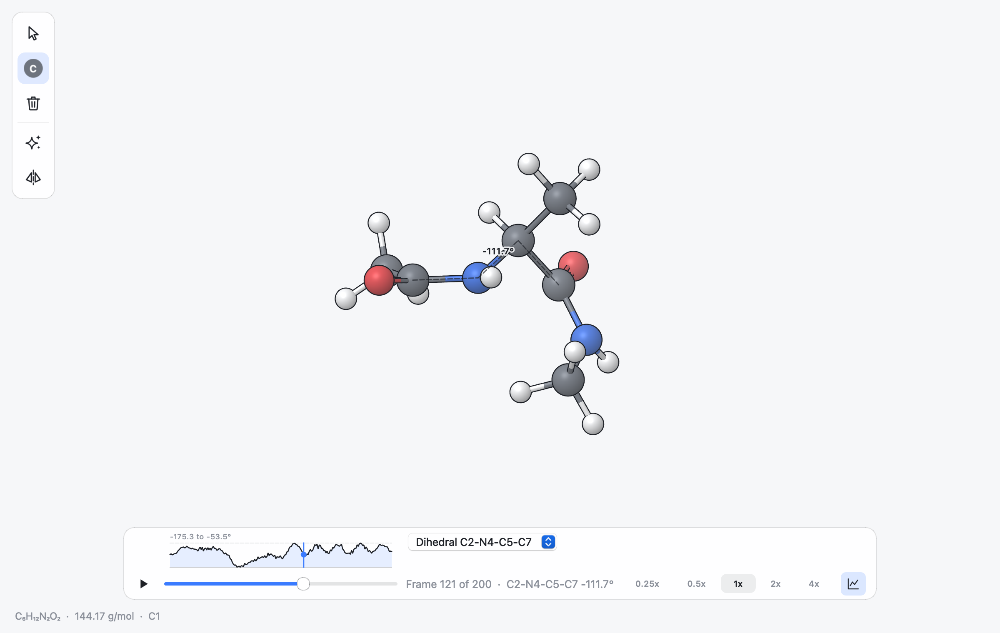
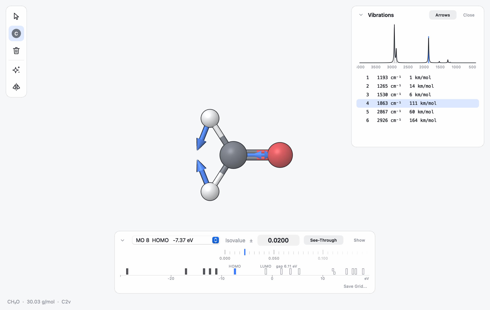
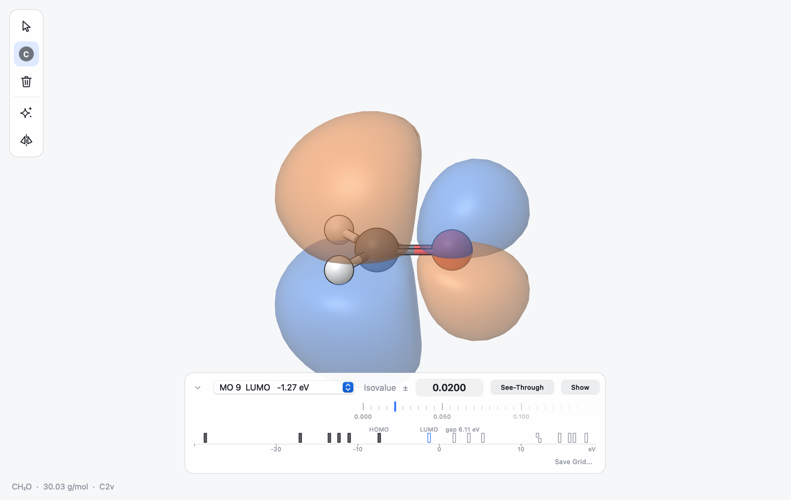
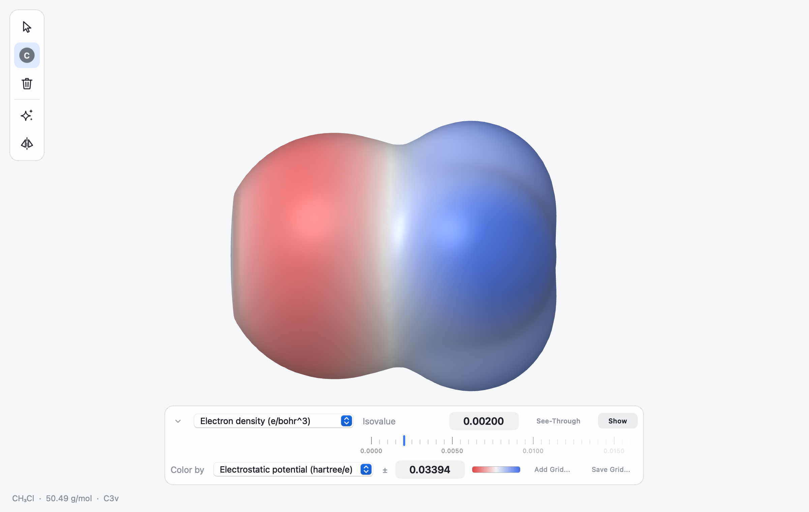

.. _ug-analysis:

Analysing Structures
####################

.. |Delta| unicode:: U+0394
.. |middot| unicode:: U+00B7
.. |deg| unicode:: U+00B0

This chapter covers molecular properties, stereochemistry, conformers,
coordinate scans, structures with several frames such as trajectories, and
the superposition of two structures.
Measurements are described in :ref:`ug-measurements` and binding pockets in
:ref:`ug-pocket`.

.. _ug-properties:

Molecular Properties
********************

**Tools > Properties** (:kbd:`Cmd I`) opens a panel on the right with the
properties of the selection, or of everything when nothing is selected. The
panel stays open and follows what you do: it updates a moment after the
selection or the structure changes and when you switch tabs, and hides for
an empty tab. **Close**, or :kbd:`Cmd I` again, hides it. It lists:

Composition
   Formula, molecular weight (from standard atomic weights), exact mass
   (the monoisotopic mass, from the most abundant isotope of each element),
   the number of atoms and the net charge.

Identifiers
   Canonical SMILES, standard InChI and InChIKey. Stereochemistry is taken
   from the 3D geometry, so building the other enantiomer changes them.

Drug-likeness
   logP and molar refractivity (Wildman and Crippen), the topological polar
   surface area (TPSA, Ertl), hydrogen-bond donors and acceptors and
   rotatable bonds, and the number of violations of Lipinski's rule of five
   (molecular weight above 500, logP above 5, more than 5 donors or 10
   acceptors). Donors and acceptors are counted as in the rule of five:
   nitrogen and oxygen atoms with hydrogen, and all nitrogen and oxygen
   atoms.

Click a value to copy it; **Copy All** copies every value as text. Long
values such as an InChI are shortened in the middle; point at them to read
them in full.

The values come from Open Babel. TPSA and logP follow the published
methods, so they agree with other programs that use them (RDKit, for
example); databases such as PubChem compute some of them differently and
can show slightly different numbers.

A selection is described together with the hydrogens bonded to it, so
selecting the heavy atoms of a ligand describes the whole ligand; the line
under the title says how many hydrogens were added.

Identifiers and drug-likeness are shown for small molecules only. For
proteins, nucleic acids and structures of more than 250 heavy atoms the
list has the composition and charge; select a ligand to see the rest. They
also need all hydrogens: when carbon atoms have too few bonds, the list
says so, and **Edit > Add Hydrogens** completes the structure.

.. _ug-stereo:

Stereochemistry
***************

**View > Stereo Labels** writes the CIP descriptor of every stereocentre
(**R** or **S**) next to the atom and the descriptor of every stereogenic
double bond (**E** or **Z**) next to the middle of the bond, in italics. The
labels are computed from the 3D coordinates, so they always describe the
structure as it is now and change as soon as you edit it.

A stereocentre is an atom other than a metal with four single bonds, at
most one of them to hydrogen, whose four substituents all have different
priorities. A double bond is labelled when it is not in a ring of fewer than
eight atoms and each end carries two substituents of different priority, or
one substituent and a lone pair, as in imines and oximes.

The priorities follow the first CIP rule only: substituents are compared by
atomic number, sphere by sphere, with duplicated atoms for multiple bonds.
Centres that differ only in isotopes, or that need the later rules, are not
labelled.

Two commands in the context menu change the stereochemistry:

**Invert Stereocentre** (right-click the atom)
   Swaps two substituents by turning them 180 degrees about the line that
   bisects their bonds, which turns R into S and back. The two smallest
   substituents that are not in a ring with the centre are chosen, and
   their own shape is kept, so a centre in a ring is inverted by moving its
   exocyclic groups. A centre whose substituents are all in rings, such as
   a spiro atom, cannot be inverted this way and a message says so.

**Flip Double Bond** (right-click the bond)
   Turns the smaller side of the molecule 180 degrees about the bond, which
   swaps E and Z. Double bonds in rings cannot be flipped.

Both are edits that can be undone. Follow them with **Clean Geometry** if
the moved groups crowd other atoms. The stereo labels appear in exported
pictures while they are switched on, and the setting is saved in session
files.

.. _ug-conformers:

Conformers
**********

**Tools > Generate Conformers** searches for low-energy shapes of a small
molecule:

1. Open Babel's genetic algorithm generates candidate conformers by turning
   the rotatable bonds.
2. Each candidate is minimised with the MMFF94 force field, or with UFF when
   MMFF94 has no parameters for the molecule.
3. Conformers within 0.25 angstrom (RMSD) of a lower-energy one are dropped,
   and the rest are sorted by energy and superposed on the original
   structure.

The search runs in the background: a bar at the top right says what is
running and has a **Cancel** link, and the window can be used meanwhile
(an edit made before the search ends makes MILES drop its result and
say so). The conformers become the frames of the document, the lowest in
energy first, and the timeline appears (:ref:`ug-timeline`) with a plot of their
energies; the frame on screen is labelled with its energy relative to the
lowest, for example "|Delta|\ E 1.20 kcal/mol". The search is meant for
small molecules: it is offered for structures of up to 200 atoms without
residue data, and a message explains when it does not apply.

To keep one conformer, step to it and carry on working: edits and saving
use the frame on screen. **Undo** right after the search returns the
structure to the coordinates it had before.

.. _ug-scan:

Scanning a Coordinate
*********************

A relaxed scan shows how the energy changes along one coordinate, for
example the rotation about a bond. Select two, three or four atoms in order
(a distance, an angle or a dihedral) and choose **Tools > Scan
Coordinate...**. The dialog shows the current value and asks for the range
and the number of steps:

.. list-table::
   :header-rows: 1
   :widths: 25 75

   * - Coordinate
     - Suggested range
   * - Distance
     - From the current length to 1 angstrom longer, in 10 steps
   * - Angle
     - 20 degrees either side of the current angle, in 8 steps
   * - Dihedral
     - A full turn from the current value, in 36 steps of 10 degrees

For each point the coordinate is set to its value by moving one side of the
molecule, as when you edit a measurement, and the rest of the structure is
relaxed with the MMFF94 force field (UFF when MMFF94 has no parameters)
while the coordinate is held fixed. Each point starts from the one before,
so the scan follows one continuous path.

The points become the frames of the document, each labelled with the value
of the coordinate, and the timeline shows the energy profile
(:ref:`ug-timeline`). Play it to watch the motion, or click the plot to go
to a point. Scans are for structures of up to 400 atoms; a dihedral scan of
a molecule of 20 to 30 atoms takes about a second. **Undo** right after a
scan returns the structure to its coordinates before the scan.

Force-field energies are good for comparing shapes of the same molecule,
such as rotamers, but not for breaking bonds: a distance scan only makes
sense near the bonded length.

.. _ug-timeline:

Trajectories and the Timeline
*****************************

A document can hold several frames: sets of coordinates for the same atoms.
Frames come from

* files with several structures that have the same atoms, such as a
  multi-model PDB file, an XYZ trajectory or the steps of a geometry
  optimisation in a quantum chemistry output;
* a conformer search (:ref:`ug-conformers`) or a coordinate scan
  (:ref:`ug-scan`);
* a vibration you are animating (:ref:`ug-vibrations`);
* session files, which keep the frames of a document.

When a document has two or more frames, a timeline appears at the bottom of
the canvas.

   Frame 121 of the alanine dipeptide trajectory in ``examples``. The pinned
   C-N-CA-C dihedral (phi) is plotted along all 200 frames; the blue line
   marks the frame on screen.

.. list-table::
   :header-rows: 1
   :widths: 35 65

   * - Control
     - Effect
   * - Play button, :kbd:`Space`
     - Play the frames in a loop, or pause on the nearest frame
   * - Slider
     - Jump to a frame
   * - :kbd:`.` and :kbd:`,`
     - Next and previous frame (wrapping around)
   * - 0.25x to 4x
     - Playback speed; 1x is 10 frames per second
   * - Plot button
     - Show or hide the plot of energy, measurements or RMSD along the frames

Next to the slider the timeline shows the frame number and, where there is
one, the frame's label, such as the value of a scanned coordinate. The keys
work when the cursor is over the canvas.

When the frames have energies, a plot above the slider shows the energy of
each frame relative to the lowest, in kcal/mol, with the highest value
written at its top left. The marker follows the frame on screen, also while
playing, and clicking or dragging along the plot goes to a frame. The
energy of the frame on screen is added to the frame text, for example
"Frame 3 of 10 |middot| |Delta|\ E 1.20 kcal/mol". Energies come from

* conformer searches and coordinate scans;
* the optimisation steps in Gaussian, NWChem and GAMESS outputs;
* XYZ files whose comment lines carry an energy in a known form: xtb
  (``energy: -5.07``), ORCA trajectories (``... E -76.3``), extended XYZ
  (``energy=-12.3`` with ``Properties=``, in eV) and CREST conformer files
  (the energy alone, in hartree);
* session files, which keep them.

Measurements and RMSD along the frames
   The plot can show other quantities too. Pin a distance, angle or
   dihedral (:ref:`ug-measurements`) and the plot appears with its value in
   every frame; a menu next to the plot chooses between the energy, each
   pinned measurement and the RMSD, and the value of the frame on screen is
   added to the frame text, for example "C2-N4-C5-C7 -111.7\ |deg|".
   Dihedrals that turn past 180 degrees are drawn as one continuous line
   (the values in the plot may then run beyond 180), while the frame text
   always gives the angle between -180 and 180 degrees.

   The RMSD compares each frame with the first after moving it onto the
   first as well as possible, so only changes of shape count, not the
   molecule drifting or turning. It uses the heavy atoms (all atoms for
   molecules with fewer than three). The plot appears by itself when there
   are energies or pinned measurements; the plot button at the right end of
   the timeline shows or hides it, for example to see the RMSD of a
   trajectory without pinning anything.

Aligning the frames
   In a molecular dynamics run the molecule drifts and tumbles, which makes
   a movie hard to follow. **Tools > Align Frames** moves every frame onto
   the frame on screen by the rotation and translation that fit it best, so
   only changes of shape remain; the frame on screen stays where it is. The
   fit uses the heavy atoms, or the selected atoms when three or more are
   selected (for example the backbone of a protein, or the rigid part of a
   flexible molecule). The shape of each frame does not change, only its
   place in space. **Edit > Undo** brings the original frames back.

Right-click the plot for **Copy Data** and **Export Data...**: a table with
one row per frame and a column for everything the plot can show, whichever
is chosen: the frame's label, the energy and the energy above the lowest
frame (kcal/mol), every pinned measurement (angstrom or degrees, dihedrals
from -180 to 180) and the RMSD from the first frame (angstrom). Copy Data
puts it on the clipboard tab-separated, ready for a spreadsheet; Export
Data saves it as a CSV file.

Playback is smooth even when the frames are far apart: the view is redrawn
about sixty times a second and the atoms move along straight lines from one
frame to the next. When the last frame is reached, a trajectory jumps back
to the first, while a vibration, whose motion is periodic, flows on without
a jump.

Editing coordinates, for example cleaning or dragging atoms, changes the
frame on screen. Adding or removing atoms ends the trajectory: the frames no
longer fit the structure, so they are dropped and the timeline disappears.
To make a movie of the frames, see :ref:`ug-movies`.

.. _ug-vibrations:

Vibrations
**********

The output of a frequency calculation contains the vibrational modes of the
molecule. When you open such a file (Gaussian and GAMESS outputs, Molden
files with a ``[FREQ]`` section, and other outputs whose vibrations Open
Babel reads), the Vibrations panel
appears at the right of the window. **Tools > Vibrations** (:kbd:`Shift Cmd V`) hides
it and shows it again; it follows the tab in front, and a tab without
vibrations shows no panel.

The panel shows the infrared spectrum, with a band of 20 cm\ :sup:`-1` width
for each mode and the highest wavenumbers on the left as usual, and below it
the list of modes with their wavenumbers and infrared intensities. Imaginary
frequencies, which mark transition states, are written with an ``i``.

Click a mode in the list or a line in the spectrum to see the atoms move.
The vibration plays through the timeline, so the speed control and the
pause button work as for any trajectory. Click **Stop** to return to the
geometry and frames you had before.

**Arrows** draws how each atom moves in the chosen mode: a 3D arrow from the
atom along its displacement, scaled so the atom that moves most gets an
arrow of about 1 angstrom, and none for atoms that hardly move. The arrows
stay while the mode plays and after Stop, so you can show a mode at rest,
and they appear in exported pictures. Choosing another mode moves them to
that mode; Arrows again, or Close, hides them. Each document keeps its own
arrows.

Right-click the spectrum or the list of modes to take the data elsewhere:

* **Copy Data** puts the modes on the clipboard (number, wavenumber in
  cm\ :sup:`-1` and IR intensity in km/mol, tab-separated with a header
  row), ready to paste into a spreadsheet. Imaginary modes have negative
  wavenumbers, as most programs print them.
* **Export Data...** saves the same table as a CSV file.
* **Export Spectrum Curve...** saves the broadened spectrum as drawn
  (absorbance, scaled so the highest band is 1) every 1 cm\ :sup:`-1` from
  the top of the axis down to 400 cm\ :sup:`-1`, for plotting it with other
  spectra.
* **Export Image...** saves the spectrum as a PNG picture (three times the
  size on screen) or an SVG drawing, on white, without the mark of the
  chosen mode.

   The C=O stretch of formaldehyde (``examples/qm/formaldehyde.molden``), the
   strongest band near 1860 cm\ :sup:`-1`, with its displacement arrows.

.. _ug-charges:

Partial Charges and Dipole
**************************

View > Charges colours atoms by their partial charge, writes the charges
next to the atoms and draws the dipole moment.

**Color by Charge**
   Negative atoms turn red, positive atoms blue and neutral atoms white.
   The scale is symmetric about zero and reaches full colour at the largest
   charge in the molecule, or at 0.5 if no charge is that large, so a nearly
   non-polar molecule stays pale.

**Charge Labels**
   The charge of each visible atom, in elementary charges, below the atom.

**Dipole Moment**
   A 3D arrow through the centre of mass, pointing from the negative
   towards the positive end, as quantum chemistry programs report it. It
   reaches beyond the outermost atoms on both sides, and is longer for
   moments larger than 1 debye per angstrom of molecule; atoms in front of
   it hide it, like any other part of the scene. Its size is written at the
   arrow head and shown in the status line.

The charges come from one of three sources, chosen at the bottom of the
menu:

**From File**
   Charges stored in the file: the Mulliken charges of a Gaussian, ORCA or
   GAMESS output, or the charges of a MOL2 file. The dipole is the one the
   calculation reported while the geometry is unchanged; after the atoms
   move, it is computed from the charges. The choice is available only for
   files with charges, and it is the default for them. Adding or removing
   atoms makes the file's charges unusable until you undo.

**Gasteiger**
   The Gasteiger-Marsili model: fast, defined for the common elements of
   organic molecules (H, C, N, O, S, P and halogens), and the default for
   files without charges.

**MMFF94**
   The charges of the MMFF94 force field, which also covers silicon and
   common ions and treats charged groups such as carboxylates better.

Both computed models depend only on the atoms and bonds, so they are not
recomputed when the molecule moves or a trajectory plays. Formal charges
are those the file stated (SDF, MOL and PDB files, SMILES); where none was
given they are worked out from the bonding: a nitrogen with four bonds is
+1, an oxygen with one bond -1. Add the hydrogens first (Edit > Add
Hydrogens): in a molecule read without its hydrogens, such as most PDB
proteins, the bonds cannot tell a hydroxyl from an anion, so only isolated
ions are charged there. If a model has no parameters for an element of the
structure, a message says so and nothing is drawn.

.. _ug-volumes:

Orbitals and Other Volumetric Data
**********************************

Cube files (``.cube``, ``.cub``) store values on a grid around a molecule:
molecular orbitals, electron densities, electrostatic potentials. Opening a
cube file shows the molecule and an isosurface of its grid, and a panel at
the bottom of the window to control it.

* **Isovalue** sets the value the surface is drawn at. Type it, drag or
  scroll the number, or drag or scroll the ruler below it. The surface
  follows as you drag.
* For orbitals, which have both signs, the panel shows a plus-minus sign:
  the positive lobes are drawn in blue at the isovalue and the negative ones
  in orange at minus the isovalue.
* **See-Through** makes the surface partly transparent, so the atoms stay
  visible; **Show** hides or shows it.
* A file with several grids, such as a cube file with several orbitals,
  gets a menu to choose between them.

The first isovalue is chosen from the data: 0.02 for orbitals and 0.002 for
densities, the usual values in atomic units, or less when the grid's values
are smaller. Without OpenGL, the QPainter renderer draws isosurfaces too,
with flat-shaded triangles.

Molden files
   Molden files (``.molden``, ``.mold``, ``.molf``), written by ORCA, xtb,
   Psi4, Molpro, CFOUR and many other programs, hold the molecular orbitals
   themselves rather than grids. The panel lists every orbital with its
   number, its name relative to the frontier orbitals (HOMO, HOMO-1, LUMO,
   LUMO+1 and so on; *alpha* and *beta* for open-shell calculations) and its
   energy in eV. The HOMO is drawn when the file opens; choosing another
   orbital computes it on a grid in a fraction of a second. Each orbital is
   computed once and kept with the document, so going back to it is instant,
   and a saved session keeps the computed grids. The isovalue stays the same
   when you move between orbitals, so their sizes can be compared.

   The same menu offers the **Electron density**, the sum of the squares of
   the occupied orbitals, and for open-shell calculations (alpha and beta
   orbitals) the **Spin density**: the alpha minus the beta density, which
   shows where the unpaired electrons are and integrates to their number
   (one for nitrogen dioxide). Both are computed on first use and kept like
   the orbitals. The spin density is drawn with two colours, blue where
   alpha spin dominates and orange where beta does, even where the beta
   regions are small; densities start at the isovalue 0.002.

   Above the isovalue ruler, an energy diagram shows the orbitals as ticks
   along an energy axis in eV: occupied orbitals filled, empty ones as
   outlines, with HOMO, LUMO and the gap between them labelled. Degenerate
   orbitals, and orbitals too close to tell apart at the current zoom, are
   stacked; zoom in to see them side by side. Open-shell calculations get two rows, alpha above beta.
   The orbital on screen is drawn in the accent colour; point at a tick to
   see its number, energy and occupation, and click it to show that
   orbital. The diagram starts at the frontier orbitals; scroll to zoom,
   drag to move along the energies, and double-click an empty spot to go
   back.

   The LUMO of formaldehyde, the pi* orbital of the C=O bond, seen with the
   molecular plane nearly edge-on. The diagram below shows the occupied
   valence orbitals (filled), the empty ones (outlines) and the 6.1 eV gap.

Colouring a surface by a second grid
   A density surface can be coloured by another grid on the same molecule,
   most often the electrostatic potential: red where it is negative (where a
   positive charge would be attracted), white near zero and blue where it is
   positive. Click **Add Grid...** in the panel and choose the file with the
   second grid, for example the potential cube written by the same
   calculation; the density surface is then coloured by it. The grid must
   belong to the same structure (same atoms at the same positions), but it
   may use a different grid spacing. **Color by** switches the colouring off
   or to another grid, and the plus-minus field sets the potential that gets
   the full red and blue; it starts at a value covering most of the surface.
   The colours read best on an opaque surface, so See-Through is switched
   off when the colouring is turned on.

Combining grids
   **Combine...** in the panel, offered when the document has two grids or
   more, makes a new grid as the difference (A - B) or the sum (A + B) of
   two of them, for example the difference between two densities: choose
   the grids, the operation and a name. A starts as the grid on screen.
   When the grids have different points, B is interpolated at the points of
   A. The result joins the document's grids, is shown at once (a difference
   in two colours, like an orbital) and is saved with sessions; Save Grid
   writes it like any other grid.

Saving a grid
   **Save Grid...** in the panel writes the grid chosen in it as a Gaussian
   cube file, with the current atoms, so other programs can draw it. This
   works for orbitals computed from a Molden file too: compute the orbital,
   then save it.

   The electron density of chloromethane at 0.002 coloured by the
   electrostatic potential from the same calculation: negative around the
   chlorine (left), positive around the methyl group.

.. _ug-superpose:

Superposing Structures
**********************

**Tools > Superpose** moves the structure of the current tab onto the
structure in another tab and reports how well they match. Open both
structures first, then, in the tab of the one that should move, choose the
command and pick the other tab.

The atoms of the two structures are paired in the first way that works:

CA atoms by sequence
   For proteins, the sequences are aligned and the CA atoms of aligned,
   identical residues are paired, so structures with different lengths or
   a few mutations can be compared.

All atoms in order
   Structures with the same atoms in the same order are paired atom by
   atom.

Heavy atoms by element and graph
   Otherwise the heavy atoms of two copies of the same molecule are paired
   by element and bonding pattern, whatever their order in the files.
   Symmetric atoms are paired to give the smallest RMSD.

The best rotation and translation for the pairs is computed with the Kabsch
algorithm and applied to the current structure. A message gives the result,
for example "RMSD 0.42 angstrom over 196 atoms (CA atoms by sequence)". If
fewer than three atoms can be paired, or the molecules differ, a message
says so and nothing moves.

With **Also add a copy to that tab, to compare them** checked (the default),
a copy of the moved structure is added to the other tab, so you can see the
two overlaid. Both changes are edits in their own tabs and can be undone
there.
