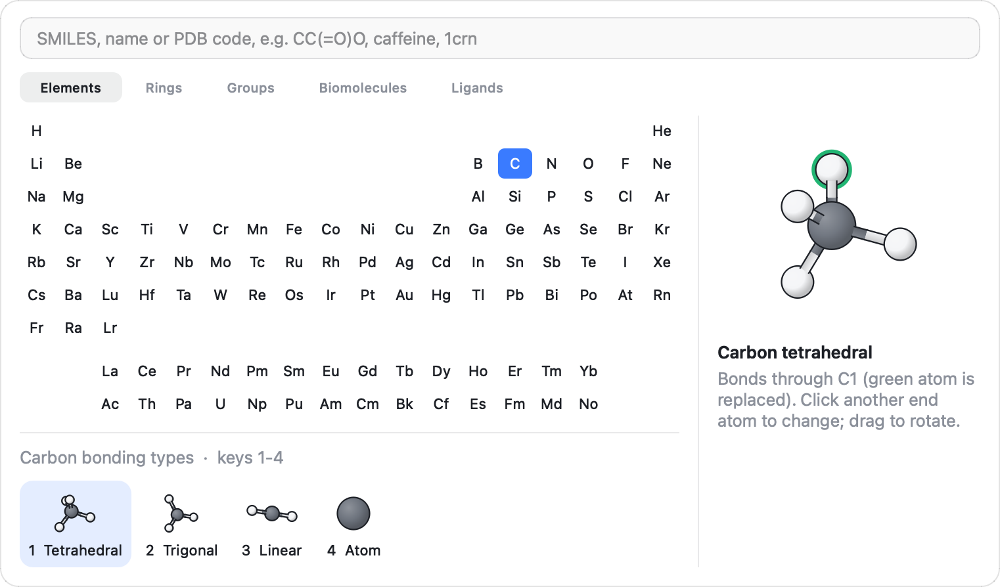

.. _ug-building:

Building Molecules
##################

The Tools
*********

The rail in the top left corner holds three tools. Exactly one of them is
active; it decides what a click on the canvas does.

.. list-table::
   :header-rows: 1
   :widths: 20 15 65

   * - Tool
     - Shortcut
     - A click on the canvas
   * - Select
     - :kbd:`Cmd 1`, :kbd:`Esc`
     - Selects atoms (see :ref:`ug-selecting`).
   * - Build
     - :kbd:`Cmd 2`
     - Places, attaches or changes atoms using the current fragment.
   * - Delete
     - :kbd:`Cmd 3`
     - Deletes the atom or bond under the cursor.

The build button shows the current fragment: a coloured disc with the
element symbol for an element, or a small picture for a ring or group.
Clicking it activates the build tool and opens the fragment popover.
:kbd:`Esc` clears the selection, or switches to the select tool when nothing
is selected.

Below the tools are two commands: **Clean geometry** and **Point group**,
described at the end of this chapter.

Fragments
*********

Everything you build is made of fragments. A fragment is a small molecule
with one *attachment atom*: a terminal atom, usually a hydrogen, that is
removed when the fragment is bonded to the structure. The atom it was bonded
to forms the new bond.

The Fragment Popover
====================

Click the build button, or choose **Tools > Fragments and SMILES**
(:kbd:`Cmd K`), to open the fragment popover.

   The fragment popover. The periodic table is on the left with the bonding
   types of the chosen element below it; the preview on the right shows the
   fragment, with the attachment atom ringed in green.

The popover has a search box at the top and five pages:

**Elements**
   A periodic table. Choosing an element shows its bonding types below the
   table. Each type sets the geometry and the number of bonds: carbon, for
   example, can be tetrahedral (sp3), trigonal (sp2) or linear (sp);
   nitrogen can be pyramidal, trigonal planar, bent with a double bond,
   linear with a triple bond or a tetrahedral cation; transition metals can
   be octahedral, square planar, tetrahedral, trigonal bipyramidal or
   linear. The last type, **Atom**, places the bare atom without hydrogens.

**Rings**
   Benzene, pyridine, pyrimidine, pyrazine, naphthalene, anthracene,
   phenanthrene, cyclopropane, cyclobutane, cyclopentane, cyclohexane
   (chair), cyclopentadiene, pyrrole, furan, thiophene and imidazole.

**Groups**
   Methyl, ethyl, isopropyl, tert-butyl, vinyl, ethynyl, phenyl, benzyl,
   hydroxyl, methoxy, thiol, amino, dimethylamino, nitro, cyano, formyl,
   acetyl, carboxyl, methyl ester, amide, trifluoromethyl, sulfonic acid
   and trimethylsilyl.

**Biomolecules**
   The twenty standard amino acids and the nucleobases adenine, guanine,
   cytosine, thymine and uracil.

**Ligands**
   Common ligands for coordination chemistry: carbonyl, cyanide, methyl
   isocyanide, ammine, aqua, hydroxo, acetonitrile, pyridine,
   trimethylphosphine, triphenylphosphine and an N-heterocyclic carbene
   (IMe).

Clicking an entry makes it the current fragment, activates the build tool
and closes the popover.

The preview on the right shows the current fragment. Drag it to turn it; new
fragments are placed in the orientation shown in the preview, relative to
your view. The attachment atom has a green ring. To bond the fragment
through a different atom, click another terminal atom in the preview, or
click a heavy atom to use its first hydrogen.

Building from SMILES, Names and PDB Codes
=========================================

Type in the search box at the top of the popover and press Return:

* A **SMILES** string, such as ``CC(=O)Oc1ccccc1C(=O)O``, is built in 3D with
  hydrogens. A ``*`` in the string marks the attachment point, so
  ``*C(=O)OC`` is a methyl ester group ready to attach.
* A **name**, such as ``caffeine`` or ``ibuprofen``, is looked up on
  PubChem, which provides a 3D structure.
* A **PDB code**, four characters starting with a digit such as ``1crn``, is
  downloaded from the RCSB Protein Data Bank and opened in a new tab (see
  :ref:`ug-proteins`).

A molecule built from SMILES or a name becomes the current fragment. In an
empty document it is placed at once; otherwise click to place it, or click a
hydrogen to attach it. If nothing is found, the reason appears below the
preview.

Placing, Attaching and Growing
******************************

With the build tool active, a click does one of the following, depending on
what is under the cursor:

Empty space
   Places a free copy of the current fragment there. For an element, the
   atom lands under the cursor with its hydrogens around it. In an empty
   document the first fragment goes to the centre of the view.

A hydrogen
   Replaces the hydrogen with the fragment. The bond order is chosen from
   the free valences on both sides, so a trigonal carbon attached to another
   trigonal carbon gives a double bond, and the fragment is turned about the
   new bond to the least crowded position (conjugated groups are kept in
   plane). Hydrogens are highlighted in green while you hover over them.

A terminal heavy atom
   For rings, groups and other fragments that are not single elements,
   clicking an atom with at most one bond attaches the fragment there too.

A heavy atom, with an element as the fragment
   Changes the atom to the current element and bonding type. Bonds to other
   heavy atoms are kept (reduced in order if the new type allows fewer), and
   the hydrogens are rebuilt to suit the new type.

A bond
   Cycles the bond order: single, double, triple and back to single. An
   aromatic bond becomes single.

A quick second click acts again, so double-clicking a hydrogen attaches two
fragments in a row. The exception is a click that placed a free fragment;
its double click does nothing more.

Growing by Dragging
===================

Drag from an atom to grow the structure in a direction. A dashed line
follows the cursor with the name of the current fragment at its end. When
you release the button over empty space, the fragment is attached to the
hydrogen of the start atom that points most nearly towards the cursor. If
the atom has no hydrogens left, a message says so.

Closing Rings
=============

Drag from one atom onto another to bond them. The line turns green when the
cursor is over a target atom. On release the two atoms are bonded: a
hydrogen dragged from or onto stands for its parent atom and is removed, and
an atom that is already saturated gives up the hydrogen pointing most
towards the other end. The molecule that now contains the new bond is then
rebuilt from its bonds and relaxed, so a freshly closed ring folds into a
sensible shape at once.

.. _ug-element-keys:

Choosing Elements from the Keyboard
***********************************

You rarely need the popover for elements. With the cursor over the canvas,
type an element symbol: :kbd:`c` for carbon, :kbd:`n` for nitrogen,
:kbd:`o` for oxygen. For two-letter symbols type both letters within about
a second: :kbd:`c` then :kbd:`l` gives chlorine, :kbd:`b` then :kbd:`r`
bromine. A message at the top of the canvas names the new fragment.

Then press a digit to choose a bonding type of that element: :kbd:`1` for
the first type in the popover, :kbd:`2` for the second and so on. For
carbon, :kbd:`2` gives a trigonal carbon and :kbd:`3` a linear one. Typing
an element or a digit also activates the build tool.

Three letters double as mouse mode keys (:kbd:`r`, :kbd:`t` and :kbd:`s`,
see :ref:`ug-navigating`). They start symbols as usual (:kbd:`r` then
:kbd:`u` gives ruthenium), and with the build tool active :kbd:`s` alone
still means sulfur. With the other tools :kbd:`s` switches to the scale mode;
pick sulfur from the popover, or press :kbd:`Cmd 2` first.

Deleting
********

With the delete tool active, clicking an atom deletes it together with its
hydrogens, and clicking a bond deletes the bond. Atoms and bonds turn red
while you hover over them.

In any tool, :kbd:`Delete` or :kbd:`Backspace` deletes the selection, or
the atom or bond under the cursor when nothing is selected.

Hydrogens and Bonds
*******************

**Edit > Add Hydrogens** (:kbd:`Option Cmd H`)
   Fills every open valence with hydrogens, placed in the free positions of
   each atom's geometry. With atoms selected, only those atoms get
   hydrogens, and the new hydrogens are added to the selection. Atoms read
   from files are completed to their usual valence. Monatomic ions (sodium,
   zinc or chloride on their own, as in many protein files) get no
   hydrogens, and neither do metal atoms read from a file: their usual
   valence says nothing about how many bonds they have. A metal you placed
   with the build tool is completed as its bonding type says.

**Add Valence** (context menu of an atom)
   Adds one hydrogen to the atom. If the atom has no free position, its
   geometry is raised to the next coordination number (tetrahedral to
   trigonal bipyramidal, for example) to make room.

**Add Hydrogens Here** (context menu of an atom)
   Completes the hydrogens of that atom only.

**Edit > Rebond**
   Throws away the bonds and works them out again from the coordinates:
   atoms closer than 1.2 times the sum of their covalent radii are bonded,
   bond orders are guessed from the bond lengths, and each atom's bonding
   type is inferred from its bonds. Use it after moving atoms by hand or for
   files that carry no bonds.

Bond orders can also be set from the context menu of a bond, and from the
selection panel when two atoms are selected (see :ref:`ug-selection-panel`).

.. _ug-clean:

Cleaning the Geometry
*********************

**Edit > Clean Geometry** (:kbd:`Cmd L`, or the sparkle button in the rail)
relaxes the structure. Two force fields are used:

MMFF94
   For organic molecules of up to 400 atoms made of H, C, N, O, F, P, S, Cl,
   Br and I. MMFF94 gives realistic bond lengths and angles, including the
   shortening of bonds next to double bonds and aromatic rings. The message
   **Cleaned with MMFF94** tells you it was used.

The built-in force field
   For everything else: metals and other elements, larger structures, atoms
   with residue data, and groups drawn with delocalised bonds outside rings,
   such as a nitro group, which MMFF94 cannot type correctly. It is made of
   bond stretching, angle bending, torsion and contact terms whose ideal
   values come from each atom's element and bonding type, and it handles any
   bonding the builder can produce.

What is relaxed depends on what you are working on:

Nothing selected, a structure you built
   The whole structure is relaxed freely. Bond lengths, angles and planar
   groups settle, and crowded atoms move apart.

Nothing selected, an experimental structure
   Atoms that belong to residues, such as those read from PDB and mmCIF
   files, are held near their starting positions by restraints. The
   structure is tidied, not rebuilt, so a crystal structure keeps its fold.
   A message reminds you that you can select atoms to rebuild them fully.

Atoms selected
   Only the selected atoms move. Atoms within 6 angstrom of them are
   included in the calculation but held fixed, so the selection settles into
   its surroundings. This is the way to fix a ligand or a side chain inside a
   protein. MMFF94 is used when the selection and its surroundings qualify
   for it.

For a molecule with rotatable bonds, Clean finds the nearest minimum, not
necessarily the lowest one. To explore other shapes, use
:ref:`ug-conformers`.

Point Group and Symmetry
************************

**Edit > Point Group** (:kbd:`Cmd G`, or the mirror button in the rail)
opens a popover with the point group of the structure. Three tolerances
decide how far atoms may be from their symmetric positions: **Tight**
(0.01 angstrom), **Normal** (0.1 angstrom) and **Loose** (0.3 angstrom).
The popover also shows the number of symmetry operations and, when it
differs, the exact point group of the coordinates as they are.

**Symmetrize** moves the atoms onto exactly symmetric positions of the group
found at the chosen tolerance. It is available when that group has more than
one operation and differs from the exact one.

Moving to the Origin
********************

**Edit > Move to Origin** translates the structure so its centre of mass is
at the origin, then centres the view. Like every edit, it can be undone.
