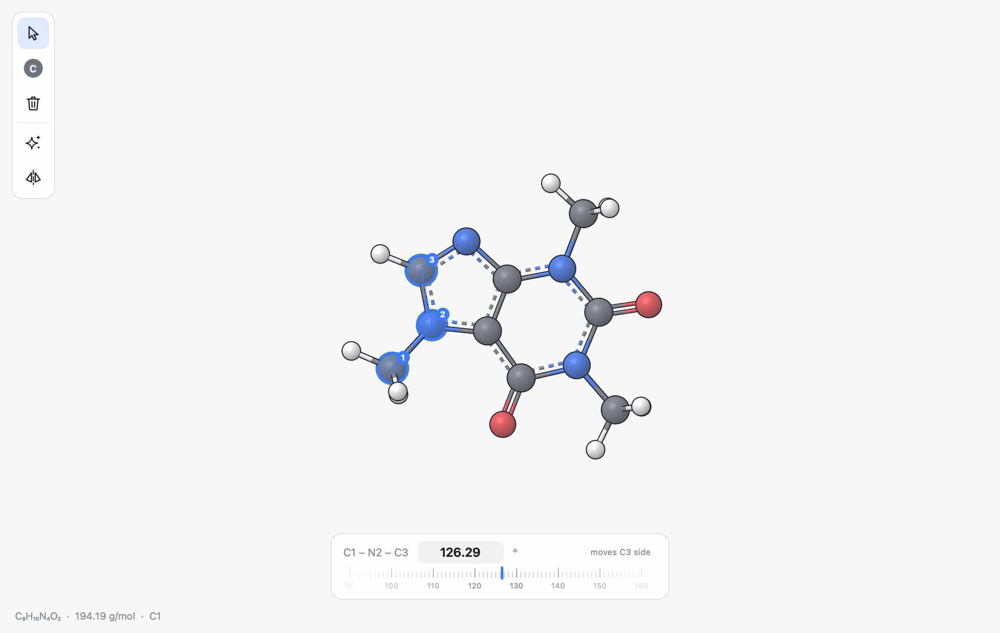

.. _ug-introduction:

Introduction
############

What MILES Is
******************

MILES is a program for building, editing and viewing molecular
structures. You can draw a small molecule atom by atom, assemble it from
rings and functional groups, type a SMILES string or a name, or open a
protein straight from the Protein Data Bank. Once a structure is on screen
you can measure and change its bond lengths, angles and dihedrals, clean up
its geometry, add hydrogens, find its point group and export a picture or a
movie for a paper or a slide.

For analysis it labels stereocentres, searches for conformers, plays
trajectories, superposes structures, shows molecular surfaces and, for
proteins, finds the residues and interactions around a ligand and mutates
residues.

MILES does not run calculations. It prepares and inspects structures;
the files it writes are meant to be read by whatever program you use next.
Nothing in it is tied to one simulation or quantum chemistry package.

Design
******

The interface is deliberately small:

* The **canvas** fills the window. Everything you build is drawn there, on
  the GPU, so rotating and zooming stay smooth even for proteins with many
  thousands of atoms.
* A **tool rail** floats in the top left corner. It holds the three tools
  (select, build and delete) and two commands (clean geometry and point
  group).
* **Popovers** open next to the rail when they are needed: the fragment
  library and the point group.
* A **selection panel** appears at the bottom of the canvas when you select
  atoms. It shows details of one atom, or the bond length, angle or
  dihedral defined by two, three or four atoms, and lets you change them.
* A few other bars appear only when they have something to show: a
  **timeline** at the bottom for structures with several frames, a
  **sequence strip** at the top for proteins and nucleic acids, and a
  **focus bar** at the top right when part of the structure is hidden.
* Everything else lives in the **menu bar** and on the **keyboard**. You can
  switch elements by typing their symbols, and most commands have a
  shortcut.

   Caffeine with three atoms selected. The selection panel shows the angle
   they define; dragging the ruler below the value changes it.

File Formats
************

MILES reads and writes structures through `Open Babel
<https://openbabel.org>`_, so it understands about 150 formats: XYZ, MOL and
SDF, MOL2, PDB, mmCIF, CML, the input and output files of the common quantum
chemistry programs, and many more. It also has its own session format,
``.miles``, which keeps the display settings of each atom, the view and the
frames. :ref:`ug-files` describes reading and writing in detail.

Conventions in This Guide
*************************

Keyboard shortcuts are written as they appear on macOS. On Linux and
Windows, read Ctrl wherever this guide says Cmd, and Alt wherever it says
Option; Qt maps the keys automatically. On macOS the Control key is a
separate modifier: Control-click opens the context menu, like a right click.

Lengths are in angstrom and angles in degrees throughout.

Getting Help
************

**Help > Shortcuts** (:kbd:`Cmd /`) lists every mouse and keyboard shortcut.
The same list, with the menu commands, is in :ref:`ug-shortcuts`. Hovering
over a button in the tool rail shows what it does and its shortcut.
**Help > Plugins...** lists the plugins that extend MILES and any
errors they had (see :ref:`ug-plugins`).
