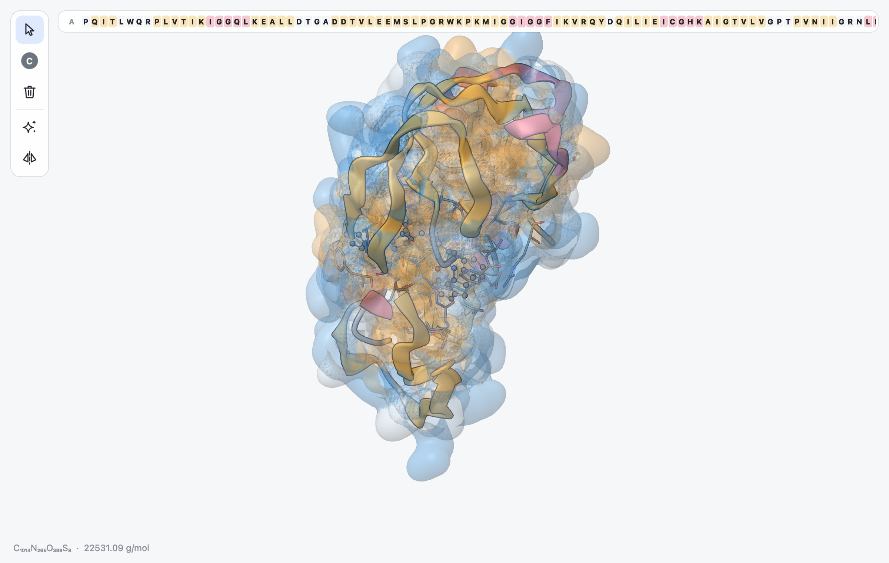
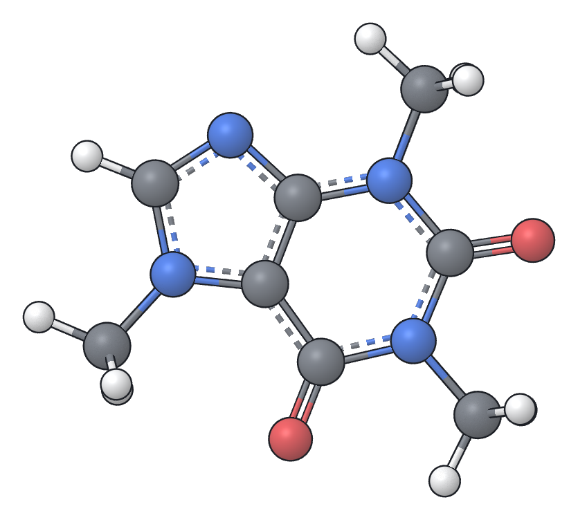

.. _ug-pictures:

Display Options, Surfaces, Pictures and Movies
##############################################

Display Options
***************

The **View** menu controls how the current document is drawn. These settings
belong to the view, not to the structure: each tab has its own. Structure
files do not keep them, but session files do (:ref:`ug-sessions`).

**Style** (:kbd:`Option Cmd 1` to :kbd:`Option Cmd 5`)
   Ball and Stick, Tube, Wire, Space Fill or Cartoon for every atom that has
   no representation of its own. With atoms selected, the style is given to
   the selection instead (:ref:`ug-representations`).

**Labels**
   Write the element symbol, the atom number, or both next to every atom.
   Labels have a halo in the background colour so they stay readable over
   other atoms. In a large structure only atoms in the window are labelled,
   at most the 1,000 nearest you, and while you turn a view with more than
   200 labels they are left out until you let go.

**Cartoon Colors**
   Colour protein and nucleic acid cartoons by secondary structure, by chain
   or as a rainbow along each chain.

**Hydrogens** (:kbd:`Shift Cmd H`)
   Show or hide all hydrogen atoms. Hidden hydrogens are still part of the
   structure; they are simply not drawn and cannot be picked.

**Stereo Labels**
   Write R or S next to stereocentres and E or Z next to stereogenic double
   bonds (:ref:`ug-stereo`).

**Hydrogen Bonds**
   Draw every hydrogen bond of the structure as a thin blue dashed line,
   from the hydrogen to the acceptor (from the donor when hydrogens are
   hidden or missing), and count them in the status line. It works for
   small molecules, complexes, proteins and nucleic acids, with or without
   hydrogens in the file, and follows edits and trajectory frames. Hidden
   atoms take no part (:ref:`ug-hydrogen-bonds` gives the criteria).

**Depth Fade**
   Fade atoms towards the background colour the further away they are. This
   gives a sense of depth in large structures. It is on by default.

**Surface**
   Show a molecular surface (see below).

**Show Only Selection**, **Hide Selection**, **Show Everything**
   Hide part of the structure while you work on the rest (:ref:`ug-focus`).

**Appearance**
   Light, dark, or following the operating system (:ref:`ug-navigating`).

The overall look is the same in every style: flat, softly shaded spheres and
cylinders with a thin dark outline. Double and triple bonds appear as two or
three cylinders in the ball-and-stick style, and aromatic bonds have a dashed
second line on the side of the ring.

.. _ug-surfaces:

Molecular Surfaces
******************

**View > Surface > Show Surface** wraps a smooth surface around the selected
atoms or, when nothing is selected, around every atom that is drawn; atoms
hidden in focus mode or with the Hidden representation, such as the water of
a protein, are left out. **Hide Surface** removes it.

The surface is the boundary of a density made of one Gaussian per atom,
which reaches the surface level at the atom's van der Waals radius. A single
atom is therefore wrapped at its van der Waals sphere, and where atoms are
close their densities merge and fill small crevices, much as a probe sphere
of 1.4 angstrom rolling over the atoms would. Separate molecules get
separate surfaces. A small molecule takes a few milliseconds and a protein
of a few thousand atoms about a second.

   HIV-1 protease with a see-through surface coloured by hydrophobicity:
   orange where the surface is apolar, blue where it is polar.

The **Surface** submenu offers five colourings. All but the electrostatic
potential give each part of the surface the colour of the nearest atom:

**Element Colors**
   The colour of the atom's element, as in the rest of the drawing. This is
   the default.

**Hydrophobicity**
   From blue (polar) through white to orange (apolar). Amino acids use the
   Kyte-Doolittle scale of their residue; other atoms are judged by element
   and neighbours, so carbon and sulfur not bonded to N or O and the
   halogens count as apolar, and nitrogen and oxygen as polar.

**Charge**
   Red for negative, white for neutral and blue for positive groups:
   aspartate, glutamate and the C-terminus; lysine, arginine, protonated
   histidine and the N-terminus; and in other molecules carboxylates,
   phosphates, sulfates, ammonium groups and simple ions.

**Electrostatic Potential**
   The potential of the molecule's charges, red where it is negative (where
   a positive charge would be attracted), white near zero and blue where it
   is positive. Unlike **Charge**, every part of the surface feels all the
   charges, so a pocket lined by several acidic groups is deep red even if
   no single atom stands out. A message gives the potential, in
   kcal/(mol e), that gets the full red and blue; the range is chosen to
   cover most of the surface, so compare colours within one picture rather
   than between structures.

   For small molecules the charges are the partial charges chosen under
   **View > Charges** (Gasteiger by default, or MMFF94, or those of the
   file), and the potential is that of the charges in vacuum, the kind of
   map quantum chemistry programs draw on a density surface. For proteins
   and nucleic acids the charges are those of the ionisable groups listed
   under **Charge** (unless **From File** is chosen and the file has
   charges), which need no hydrogens and no protonation model, and the
   charges are screened by a dielectric that grows with distance
   (4 times the distance in angstrom), as in the Coulombic colouring of
   UCSF Chimera. The potential is evaluated 1.4 angstrom outside the
   surface, where the centre of a water molecule touching it would be.
   Computing it adds a few milliseconds for small molecules and at most
   about a second for a protein of several thousand atoms to the time the
   surface itself takes.

**One Color**
   A neutral grey that suits figures where the shape matters most.

**See-Through** makes the surface partly transparent, so the cartoon, the
ligand and the atoms inside stay visible. The colouring and See-Through
are remembered for the next surface when no surface is shown.

The surface is computed again after each edit; while you drag atoms it keeps
its old shape and catches up when you let go. Each tab has its own surface.
Both renderers draw surfaces. The QPainter renderer (``--software``, used
when OpenGL is not available) shades each triangle flat and simplifies large
surfaces, so they look faceted but keep their shape and colours. Surfaces are
included in exported pictures and movies, but not saved in session files.

Exporting Pictures
******************

**File > Export Image** (:kbd:`Shift Cmd E`) makes a PNG picture of the
current view for a paper, a poster or a slide. The picture shows the
structure exactly as the canvas does, with the same orientation, zoom,
representations, colours and surface. Pinned measurements, hydrogen bonds,
the interaction lines of a pocket view and stereo labels are drawn too. The selection
highlights, atom labels, tool rail, panels and status line are left out.

   Caffeine exported at 2x on a white background with ambient occlusion and
   cropping.

The export dialog shows a preview and these options:

**Size**
   1x, 2x or 4x the size of the canvas in pixels. The resulting dimensions
   are shown next to the buttons. Very large sizes are limited by what the
   graphics card supports.

**Background**
   The theme's background colour, plain white, or transparent. With a
   transparent background, depth fading is turned off so atoms keep their
   colours, and the preview shows a checkerboard behind the picture.

**Ambient occlusion**
   Darken creases and the parts of the structure that are hidden by
   others, which makes the shape easier to read. It is computed on the GPU
   and is not available with the QPainter renderer (``--software``).

**Crop to molecule**
   Trim the empty border around the structure, leaving a small margin.

Click **Save PNG** and choose a file name. The options are remembered for the
next export.

Tips for Figures
================

* Turn and zoom the view first; the picture uses exactly what you see. The
  axis views in the **View** menu help for symmetric molecules.
* A white background with ambient occlusion and cropping at 2x or 4x suits
  most journals. Use a transparent background to place the picture on a
  coloured slide.
* For proteins, show the cartoon with the ligand and nearby side chains as
  balls and sticks or tubes; hide water, which is the default.
* Hide hydrogens (:kbd:`Shift Cmd H`) to reduce clutter in large organic
  molecules.
* Pin the distances or angles you discuss in the text; they are drawn in
  the picture (:ref:`ug-measurements`).

.. _ug-drawings:

2D Drawings
***********

**File > Export 2D Drawing** saves a skeletal formula of the selection
(with the hydrogens bonded to it), or of everything, as an SVG or a PNG
file; **Edit > Copy 2D Drawing** puts it
on the clipboard, as a picture and as SVG for programs that accept it.
Open Babel lays the molecule out in two dimensions and draws it:
carbons are drawn as plain line ends and corners, also at the ends of
chains (no CH\ :sub:`3` labels), heteroatoms carry their hydrogens (OH,
NH\ :sub:`2`), formal charges are shown, and stereocentres get a wedge or
hash bond with the configuration of the 3D structure. SVG files have a
transparent background and can be edited further in a vector drawing
program; PNG files are white and about four pixels per drawing unit, large
enough for documents and slides.

Drawings are meant for small molecules; for a protein, select the ligand
first. Structures of more than 250 heavy atoms are not drawn.

.. _ug-movies:

Exporting Movies
****************

**File > Export Movie** records the current view as a movie, for slides and
supplementary material. The dialog offers:

**Movie**
   **Turntable**: one full turn about the vertical axis of the screen.
   **Trajectory**: every frame of the document in turn, available when the
   document has frames (:ref:`ug-timeline`), and chosen by default then.

**Length**
   The duration of a turntable, from 2 to 60 seconds; movies run at 30
   frames per second. A trajectory movie has one movie frame per document
   frame.

**Size**
   1x or 2x the size of the canvas.

**Background**
   The theme's background or white.

**Ambient occlusion**
   As for pictures; it makes each frame slower to render.

**Format**
   **MP4** or **GIF**, or **PNG frames**: a folder of numbered pictures
   (``frame_0000.png``, ``frame_0001.png`` and so on) that any video tool can
   assemble.

MP4 and GIF files are made with `ffmpeg <https://ffmpeg.org>`_, which is not
installed with MILES. If the dialog finds no ``ffmpeg`` program, only
PNG frames are offered; install it in the same environment with

.. code-block:: bash

   micromamba install -n miles -c conda-forge ffmpeg

Click **Save** and choose a file, or a folder for PNG frames. A progress
dialog shows the frames being rendered and can cancel the export. The
camera and the frame on screen are restored afterwards. Like pictures,
movie frames include the surface, pinned measurements, hydrogen bonds,
interaction lines and stereo labels.
