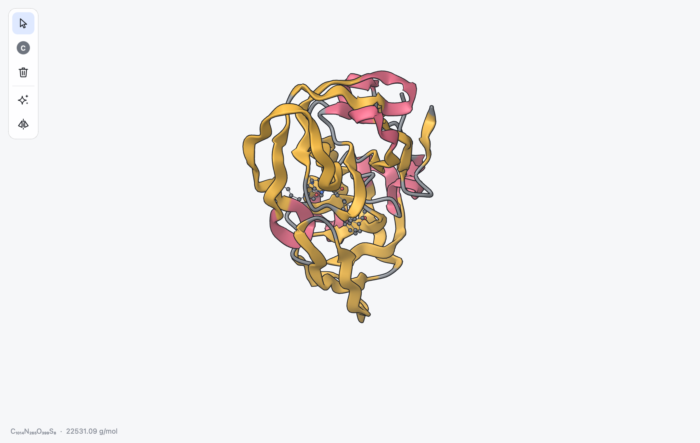
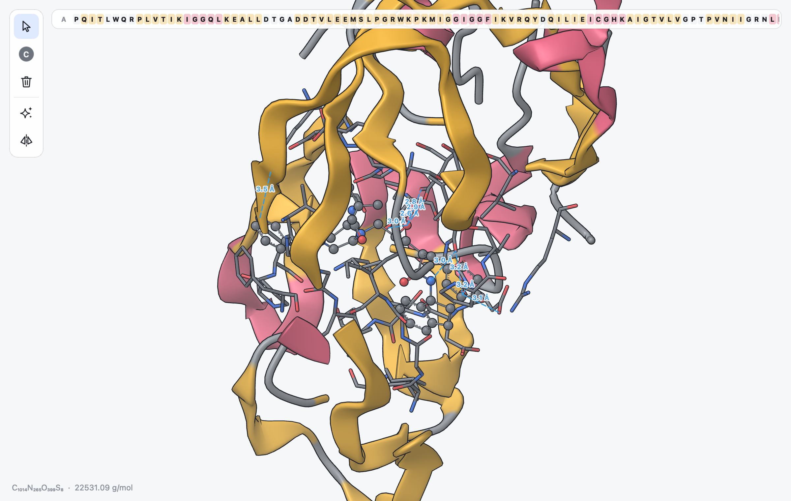
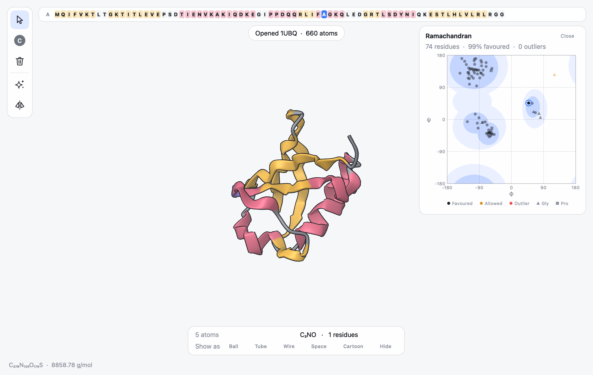

.. _ug-proteins:

Proteins and Nucleic Acids
##########################

MILES treats biomolecules like any other structure: you can select,
edit, clean and save them. A few features make large structures easier to
work with: cartoon drawing, per-atom representations, selection by residue,
chain or kind of molecule, and a sequence strip. Two more help with
ligands and design: the binding pocket view and residue mutation.

Opening a PDB Entry
*******************

There are three ways to download an entry from the RCSB Protein Data Bank by
its four-character code:

* type the code, for example ``1crn``, in the search box of the fragment
  popover (:kbd:`Cmd K`) and press Return;
* choose **File > Open from PDB** (:kbd:`Shift Cmd O`) and enter the code;
* give the code on the command line: ``miles 4hhb``.

The entry opens in a new tab. If the PDB format is not available for an
entry, the mmCIF file is used instead. You can of course also open PDB and
mmCIF files from disk (:ref:`ug-files`).

   HIV-1 protease with a bound inhibitor (PDB entry 1HSG). The protein is
   drawn as a cartoon coloured by secondary structure, the inhibitor as
   balls and sticks; water is hidden.

How Biomolecules Are Shown
**************************

When a structure with protein or nucleic acid chains opens, MILES
chooses a starting representation for you:

* amino acid and nucleotide residues are drawn as a **cartoon**: a ribbon
  through the backbone that is round in loops, flat in helices and an arrow
  in strands; nucleic acids get a tube through their phosphates;
* **water** is hidden;
* everything else, such as ligands, ions and cofactors, is drawn in the
  view's style, balls and sticks by default.

The select tool becomes active, since you usually want to inspect a
structure you have just opened.

Helices and strands come from the file when it records them. Chains without
this information get an estimate from the distances between their CA atoms,
which finds most helices and strands.

In a cartoon you can pick residues by their CA atom (P for nucleic acids),
which sits on the ribbon.

.. _ug-representations:

Representations
***************

Every atom can be drawn in its own way. There are six representations:

.. list-table::
   :header-rows: 1
   :widths: 25 75

   * - Representation
     - Drawing
   * - Ball and Stick
     - Spheres for atoms, cylinders for bonds. Double and triple bonds are
       drawn as two or three cylinders, aromatic bonds with a dashed line.
   * - Tube
     - Atoms and bonds as one smooth tube of uniform width.
   * - Wire
     - Thin lines of constant width in pixels.
   * - Space Fill
     - Spheres at the van der Waals radius.
   * - Cartoon
     - The backbone ribbon; only for amino acids and nucleotides. Other atoms
       set to cartoon are drawn as tubes.
   * - Hidden
     - Not drawn.

To change how atoms are drawn:

* select them and click a button in the **Show as** row of the selection
  panel;
* select them and choose **View > Style**, or use the context menu's **Show
  Selection As**;
* with nothing selected, **View > Style** (:kbd:`Option Cmd 1` to
  :kbd:`Option Cmd 5`) sets the style of the whole view and clears the
  per-atom choices, while the context menu's **Show Everything As** gives
  every atom the chosen representation.

Changes of representation are edits: they can be undone and they are kept in
session files (:ref:`ug-sessions`).

Selecting Parts of a Structure
******************************

The **Select** submenu of the context menu (:ref:`ug-context-menu`) selects
groups of atoms:

**Residue** and **Chain**
   The residue or the chain of the atom under the cursor.

**Protein and Nucleic Acids**
   Every atom in an amino acid or nucleotide residue.

**Ligands**
   Atoms marked as heteroatoms in the file that are neither water nor amino
   acids: drug molecules, cofactors, ions and so on.

**Water**
   All water molecules.

**Everything**
   All atoms.

Double-clicking also selects a residue, then its chain, then everything
(:ref:`ug-selecting`). A message tells you when a structure has no atoms of
the kind you asked for.

A typical way to look at a binding site is to choose **Select > Ligands**,
click **Ball** in the selection panel, and click empty space to clear the
selection. The binding pocket view (:ref:`ug-pocket`) does this and more in
one step.

.. _ug-sequence:

The Sequence Strip
******************

When a structure contains amino acids or nucleotides, a strip along the top
of the canvas shows its sequence: one cell per residue with its one-letter
code, in file order, with the name of each chain before it. The cells are
coloured like the cartoon: pink for helices, yellow for strands and a faint
grey for loops. Residues that contain selected atoms are highlighted.

* **Click** a residue to select it. The select tool becomes active.
* **Drag** across residues to select a stretch of them.
* **Shift-click** or **Cmd-click** (or drag) to add residues to the
  selection.
* **Scroll** over the strip to move along a long sequence.
* **Hover** over a residue to see its name, number and chain.

The strip follows the structure as you edit it, for example after a
mutation.

.. _ug-pocket:

Binding Pockets
***************

To see how a ligand sits in a protein, right-click any atom of the ligand
and choose **Show Binding Pocket**. The command is offered for atoms that
are not part of an amino acid, nucleotide or water, in structures that
contain a protein or nucleic acid. MILES then:

1. takes the ligand: the atom's residue when the file has residue data,
   otherwise the whole molecule the atom belongs to;
2. finds the pocket: every residue with an atom within 5 angstrom of the
   ligand, as whole residues, leaving out water;
3. draws the pocket residues as tubes and the ligand as balls and sticks,
   showing them if they were hidden, and zooms to them;
4. finds the interactions between the ligand and the pocket and draws each
   as a dashed line labelled with its length.

   The pocket of HIV-1 protease around its inhibitor (PDB 1HSG): pocket
   residues as tubes, the inhibitor as balls and sticks, and hydrogen bonds
   as blue dashed lines.

A message sums up the pocket, for example "Pocket of 33 residues, 9 hydrogen
bonds". Three kinds of interaction are found:

.. list-table::
   :header-rows: 1
   :widths: 20 12 68

   * - Interaction
     - Colour
     - Found when
   * - Hydrogen bond
     - blue
     - An N, O or S donor and an N or O acceptor are 2.4 to 3.5 angstrom
       apart. If the donor carries hydrogens, one of them must point at the
       acceptor (a D-H...A angle above 120 degrees); structures without
       hydrogens are judged on distance alone.
   * - Salt bridge
     - orange
     - The centres of two oppositely charged groups are within 4.0
       angstrom: lysine, arginine and protonated histidine against
       aspartate, glutamate and the C-terminus, and in ligands carboxylates,
       phosphates, sulfates, ammonium groups and amidines.
   * - Pi stacking
     - green
     - Two aromatic rings are stacked (planes within 30 degrees, centres
       within 5.5 angstrom) or T-shaped (60 to 90 degrees, within 6.0
       angstrom).

The labels show the current distance between the ends of each line, so they
follow the atoms if you move them. **Clear Interactions** in the context
menu removes the lines; adding or removing atoms also clears them. The
lines appear in exported pictures but are not saved in session files.

.. _ug-hydrogen-bonds:

Hydrogen Bonds
**************

**View > Hydrogen Bonds** draws all hydrogen bonds of a structure, not only
those between a ligand and its pocket: the backbone bonds that hold helices
and sheets together, side-chain bonds, base pairs in DNA and RNA, and bonds
to water. Each is a thin blue dashed line from the hydrogen to the acceptor,
and the status line gives their number. In a cartoon, lines to backbone
atoms end on the ribbon, at the point nearest to the atom, which shows the
helices' i to i+4 pattern and the ladders between strands. Bonds to side
chains and bases that the cartoon does not draw are left out (show those
residues as tubes or balls to see them), and the status line then says how
many of the bonds are drawn.

The criteria are those of the pocket view, with a few additions so that a
whole structure gives no spurious bonds:

* donor and acceptor are 2.4 to 3.5 angstrom apart and more than three
  bonds apart (so atoms of the same five- or six-membered ring never pair);
* with hydrogens in the file, one of the donor's hydrogens makes a D-H...A
  angle above 120 degrees;
* nothing is accepted from behind: the hydrogen bond makes angles above 90
  degrees with the bonds of both atoms to their heavy neighbours;
* acceptors are oxygens and nitrogens with a free lone pair, so amide,
  aniline and ring NH nitrogens and ammonium groups do not accept.

Most PDB entries have no hydrogens. Then the donors of amino acids and
nucleobases are known by atom name, the hydrogen of a backbone or ring NH,
which lies in the plane of its bonds, is placed where it must be (as DSSP
does) and the angle is checked as usual, and other donors (hydroxyls,
water, amino groups) are judged on distance and the heavy-atom angles. A
built alpha helix gives the same i to i+4 bonds with or without hydrogens,
and a DNA duplex its Watson-Crick pairs.

Atoms hidden in focus mode take no part. The lines follow edits and
trajectory frames; for structures large enough that the search takes more
than a few milliseconds, playback updates them several times a second
rather than every frame, and they catch up when it stops. They appear in
exported pictures and movies, and the setting is saved with the view in
sessions.

.. _ug-mutate:

Mutating Residues
*****************

To change an amino acid into another, right-click any of its atoms, open
**Mutate** (followed by the residue name and number) and choose the new
residue from the twenty standard ones.

The backbone stays where it is: N, CA, C, O and OXT with their hydrogens.
The old side chain is removed, and the new one is taken from a template,
fitted onto the residue's N, CA and C. Its rotation about the CA-CB bond,
and about the CB-CG bond where that applies, is chosen in 30-degree steps to
be the least crowded among the atoms within 8 angstrom. Side-chain hydrogens
are added only if the residue had hydrogens before. For proline the ring is
closed onto the backbone nitrogen.

The new residue keeps the number, chain and representation of the old one
and uses standard PDB atom names. Its side-chain atoms are selected
afterwards, so **Clean Selection** (:kbd:`Cmd L`) can relax them in their
surroundings straight away. Like any edit, a mutation can be undone.

Building from a Sequence
************************

Tools > Build from Sequence builds a peptide, DNA or RNA from its one-letter
sequence and opens it in a new tab. Type or paste the sequence; spaces,
numbers and FASTA header lines are ignored. Choose what to build:

**Protein Helix**
   An alpha helix (phi -57, psi -47 degrees).

**Protein Strand**
   An extended beta strand (phi -120, psi 130 degrees).

**DNA**, **Single DNA**
   A B-DNA double helix with its complementary strand, or one strand.

**RNA**
   A single RNA strand.

Proteins have standard atom names, hydrogens and free termini, and their
side chains are placed without clashes. The secondary structure is set, so
the cartoon shows the helix or strand at once. Building takes a moment for
long sequences; the dialog stays responsive meanwhile.

Preparing a Protein
*******************

Structures from the PDB often lack hydrogens and parts of side chains that
were not resolved in the experiment. Tools > Prepare Protein fixes these in
one undoable step:

**Complete missing side chains**
   Residues whose side chains are incomplete (the dialog counts them) are
   rebuilt, as when mutating a residue to itself.

**Add hydrogens for pH**
   All hydrogens are replaced by hydrogens for the pH you choose (7.4 by
   default). Each ionisable group of the standard amino acids is protonated
   when the pH is below its typical pKa: aspartate 3.9, glutamate 4.1,
   histidine 6.0, cysteine 8.3, tyrosine 10.1, lysine 10.5, arginine 12.5,
   the N-terminus 8.0 and the C-terminus 3.1. A neutral histidine carries
   its hydrogen on the ring nitrogen that can donate a hydrogen bond, or on
   NE2 when neither or both can; nitrogens bound to a metal (the iron of a
   heme, a zinc) and cysteines in disulfide bridges get no hydrogen.
   Residue names that fix a state, such as HID, HIE, HIP, ASH, GLH, LYN and
   CYX, are respected. Ligands, nucleic acids and unusual residues are
   protonated by Open Babel's pH model.

**Remove water**
   Deletes the water molecules.

.. _ug-ramachandran:

Ramachandran Plot
*****************

**Tools > Ramachandran Plot** (:kbd:`Option Cmd R`) shows or hides a panel on the right with the backbone
dihedrals of every amino acid: phi (C-N-CA-C) across and psi (N-CA-C-N) up,
both from -180 to 180 degrees.

   Ubiquitin (PDB 1UBQ). The selected residue, Ala 46, is ringed; it is one
   of the few residues in the left-handed helix region.

Each point is a residue. Residues are linked through their peptide bonds (a
C-N distance below 2 angstrom), so gaps in the numbering do not matter, but
the first and last residue of each chain and the residues on either side of
a missing stretch lack one of the two angles and are left out.

The shaded areas are the regions most residues fall in: the darker inner
areas are favoured, the lighter ones around them allowed. They are the
right-handed helix (left, just below the middle), the beta strand and
polyproline region (top left) and the left-handed helix (right, just above
the middle). The colour of a point says where the residue falls:

* black (white in the dark theme): favoured,
* orange: allowed,
* red: outlier.

Glycine (triangles) has no side chain and reaches regions other residues
cannot; proline (squares) has its phi held near -65 degrees by its ring; and
the residue before a proline is more restricted than usual. Each of these
is judged against its own regions, so a glycine can be favoured where the
shading is empty. The line above the plot gives the number of residues, the
share in favoured regions and the number of outliers.

Point at a residue to see its name, number, chain and angles. Click it to
select the residue in 3D, or Shift-click to add it to the selection. The
residues of the current selection are ringed and the others are faded, so
selecting a helix or a stretch of the sequence strip shows where it lies on
the plot. The plot follows edits and the frame shown, so playing a
trajectory or stepping through conformers moves the points.

Right-click the plot to copy or save it. **Copy Data** and **Export
Data...** give one row per residue (chain, residue name and number, phi,
psi and region; empty where an angle is missing), on the clipboard for a
spreadsheet or as a CSV file. **Export Image...** saves the plot as a PNG
picture or an SVG drawing, on white and without the selection rings.

.. note::

   The regions are simple ellipses that follow the familiar shapes of the
   plot. They are good for a quick look at a structure and for spotting
   unusual residues, but they are approximate; validate structures for
   publication with a dedicated program.

Cartoon Colours
***************

**View > Cartoon Colors** offers three colourings:

**Secondary Structure**
   Helices pink, strands yellow and loops grey.

**Chain**
   One colour per chain.

**Rainbow**
   Each chain runs from blue at its start to red at its end.

Editing Biomolecules
********************

The building and editing tools work on biomolecules as well. Two of them
behave in a way suited to experimental structures:

Clean Geometry
   Without a selection, atoms that belong to residues are restrained to
   their positions, so cleaning a protein only tidies it. To rebuild part of
   a structure, select it first: the selected atoms are then relaxed freely
   while everything within 6 angstrom is held fixed (:ref:`ug-clean`).

Add Hydrogens
   Structures from the PDB usually lack hydrogens. **Edit > Add Hydrogens**
   adds them to the selection, or to every atom. New hydrogens belong to the
   same residue as their parent atom and are drawn the same way, so the
   hydrogens of residues shown as cartoon stay out of sight.
