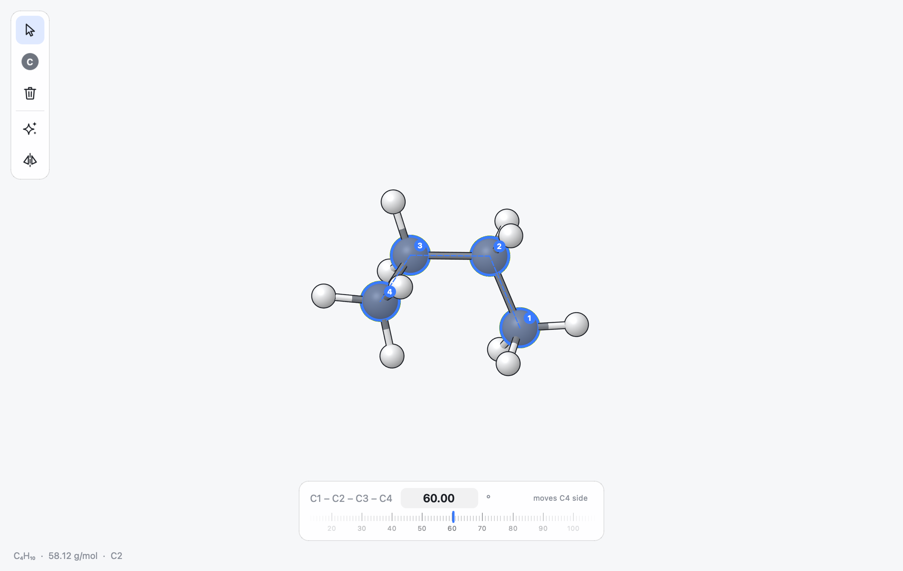

.. _ug-selecting:

Selecting and Editing
#####################

Selecting Atoms
***************

Switch to the select tool with :kbd:`Cmd 1`, :kbd:`Esc` or the arrow button
in the rail. Then:

* **Click an atom** to select it alone.
* **Click a bond** to select its two atoms.
* **Shift-click** (or Cmd-click) an atom to add it to the selection, or to
  remove it if it is already selected. Shift-clicking a bond adds its atoms.
* **Click empty space** to clear the selection; :kbd:`Esc` does the same.
* **Double-click** an atom to select its residue; double-click again for its
  chain, and once more for everything. For a molecule without residue
  information, the first double click selects the whole molecule.
* **Edit > Select All** (:kbd:`Cmd A`) selects every atom.
* **Edit > Select...** (:kbd:`Cmd F`) selects the atoms an expression
  describes, such as ``byres within 5 of ligand`` or ``protein and name CA``
  (see :ref:`ug-selections`).

Selected atoms are drawn with a blue ring. In a protein cartoon, the
residues that contain selected atoms are tinted blue. Switching to the build
or delete tool clears the selection.

The order in which you select atoms matters. Two, three or four selected
atoms define a bond length, an angle or a dihedral, in the order you clicked
them: the angle 1-2-3 has its vertex at the second atom, and the dihedral
1-2-3-4 turns about the bond between the second and third. While two to four
atoms are selected, small numbered badges and a dashed line show this order.

.. _ug-selection-panel:

The Selection Panel
*******************

When atoms are selected, a panel appears at the bottom of the canvas. What
it shows depends on how many atoms are selected.

One atom
   The atom's residue and name (for atoms from proteins and other
   biomolecules), its element, its bonding geometry, the atoms it is bonded
   to and its coordinates.

Two, three or four atoms
   The bond length, angle or dihedral they define, in a field you can edit,
   with a ruler (the dial) below it. The atoms do not have to be bonded.

Five or more atoms
   The number of atoms, the formula of the selection and, for biomolecules,
   the number of residues.

With one atom or more than four, the panel also has a **Show as** row that
draws the selected atoms as balls and sticks, tubes, wires, space-filling
spheres, cartoon, or hides them (see :ref:`ug-representations`).

Changing Bonds, Angles and Dihedrals
====================================

   Four atoms of butane selected. The panel shows their dihedral, here set to
   60 degrees; the button on the right says which part of the molecule
   moves.

There are several ways to change the value:

* **Drag the field sideways** to scrub the value up and down.
* **Click the field** and type a number, then press Return. :kbd:`Esc`
  restores the current value.
* **Press the Up and Down arrows** in the field to step the value; hold
  Shift for steps ten times larger.
* **Scroll over the field.**
* **Drag the dial** below the field like a tape measure, or scroll over it
  to move one tick at a time. Major ticks are labelled.
* **Option-scroll anywhere on the canvas** to move the dial while keeping
  your eyes on the molecule.

Holding Option while dragging the field or the dial makes the change five
times finer. Distances range from 0.3 to 12 angstrom and angles from 0 to
180 degrees; dihedrals run from -180 to 180 degrees and wrap around.

Which atoms move is set by the button on the right of the panel. Click it
to cycle through four modes:

**moves C4 side** (the last atom's side)
   The last atom moves together with everything bonded to it on its side of
   the bond, angle or dihedral. This is the default.

**moves C1 side** (the first atom's side)
   The first atom's side moves instead.

**moves both sides**
   Both sides move by half the change each.

**moves C4 only** (the last atom only)
   Only the last atom moves, with any hydrogens or other terminal atoms on
   it.

When the two ends are joined through a ring, a whole side cannot move
without distorting the ring; then only the end atom and its terminal atoms
move.

All the changes you make while the same atoms stay selected form one undo
step, so :kbd:`Cmd Z` takes you back to where you started.

Bond Orders
===========

With two atoms selected the panel also shows five buttons for the bond
between them: single, double, triple, aromatic and no bond. Clicking one
creates, changes or removes the bond.

.. _ug-measurements:

Pinning Measurements
====================

A measurement normally disappears with the selection. To keep it on screen,
pin it: with two, three or four atoms selected, click the pin button on the
right of the selection panel, or choose **Pin Measurement** in the context
menu. The distance, angle or dihedral is then drawn as a dashed line through
the atoms with its current value, for example 1.54 angstrom or 109.5
degrees, and the value follows the atoms as they move.

Clicking the pin button again with the same atoms selected unpins that
measurement; **Edit > Clear Measurements**, also in the context menu,
removes all of them. Pinned measurements appear in exported pictures, are
saved in session files and are not shown for hidden atoms. Pinning and
unpinning are edits, so they can be undone.

Moving and Rotating Atoms
*************************

You can move parts of the structure by dragging:

* With the select tool, **drag a selected atom** to move the whole selection
  in the plane of the screen.
* **Option-drag** rotates the selection about its centre when the select
  tool is active and atoms are selected. Otherwise it rotates the molecule
  under the cursor (all atoms connected to it).
* **Option-Shift-drag** moves the selection or the molecule instead of
  rotating it.

Each drag is one undo step.

.. _ug-undo:

Undo and Redo
*************

**Edit > Undo** (:kbd:`Cmd Z`) and **Edit > Redo** (:kbd:`Shift Cmd Z`)
step through the last 200 changes of the current document. Every edit is
recorded: building, deleting, cleaning, changing values in the selection
panel, changing representations, hiding and showing atoms, pinning
measurements, mutating residues, superposing and editing in the atom list.
Moving the view, stepping through frames and showing a surface are not
edits and are not recorded.

The Clipboard
*************

**Copy** (:kbd:`Cmd C`) and **Cut** (:kbd:`Cmd X`)
   Copy the selection, or the whole structure when nothing is selected. The
   clipboard receives two versions: one for MILES, which keeps bond
   orders and bonding types exactly, and plain XYZ text that other programs
   understand.

**Paste** (:kbd:`Cmd V`)
   Inserts what is on the clipboard. Besides atoms copied in MILES,
   paste accepts text in these forms:

   * XYZ, MOL and SDF, MOL2, PDB, mmCIF, CML and Gaussian input files;
   * plain lines of ``symbol x y z``, where extra columns are ignored and a
     number after the symbol (``C1``) is dropped;
   * a single SMILES string.

   If the pasted atoms would overlap the structure, they are moved beside it
   (to the right in the current view). They are selected and the select tool
   becomes active, so you can drag them into place at once.

**Duplicate** (:kbd:`Cmd D`)
   Pastes a copy of the selection, or of everything, in one step.

**Copy SMILES** (:kbd:`Shift Cmd C`)
   Puts the canonical SMILES string of the selection, or of everything, on
   the clipboard. Stereochemistry is taken from the 3D coordinates.

The Atom List
*************

**Edit > Atom List** (:kbd:`Shift Cmd A`) opens a table of all atoms with
their element symbol, Cartesian coordinates and the atoms they are bonded
to. Edit a symbol or a coordinate and press Return to change the structure;
each change is an undoable edit. The table follows the structure while you
work in the main window.

.. _ug-context-menu:

The Context Menu
****************

Right-click (or Control-click) on the canvas for a menu of commands for what
is under the cursor.

Over an atom
   **Change Element** to one of the common elements, **Add Hydrogens
   Here**, **Add Valence**, **Delete Atom** and **Rotate Around This
   Fragment**. Depending on the atom there are also:

   * **Invert Stereocentre**, with its current label, for a stereocentre
     (:ref:`ug-stereo`);
   * **Mutate**, followed by the residue name and number, for an atom of an
     amino acid (:ref:`ug-mutate`);
   * **Show Binding Pocket** for an atom of a ligand in a structure with a
     protein or nucleic acid (:ref:`ug-pocket`).

Over a bond
   **Single**, **Double**, **Triple** or **Aromatic** (the current order is
   checked), **Delete Bond**, and **Flip Double Bond** with its current E
   or Z label for a stereogenic double bond.

Always
   **Select**, with **Residue** and **Chain** of the atom under the cursor,
   **Protein and Nucleic Acids**, **Ligands**, **Water** and **Everything**;
   **Show Selection As** (or **Show Everything As**) a representation;
   **Show Only Selection** and **Hide Selection** when atoms are selected,
   **Show Everything** when atoms are hidden (:ref:`ug-focus`); **Pin
   Measurement** with two to four atoms selected, **Clear Measurements**
   and **Clear Interactions** when there are any; **Delete Selection**;
   **Add Hydrogens**; **Clean Geometry** (or **Clean Selection**); and
   **Fit to Window**.
